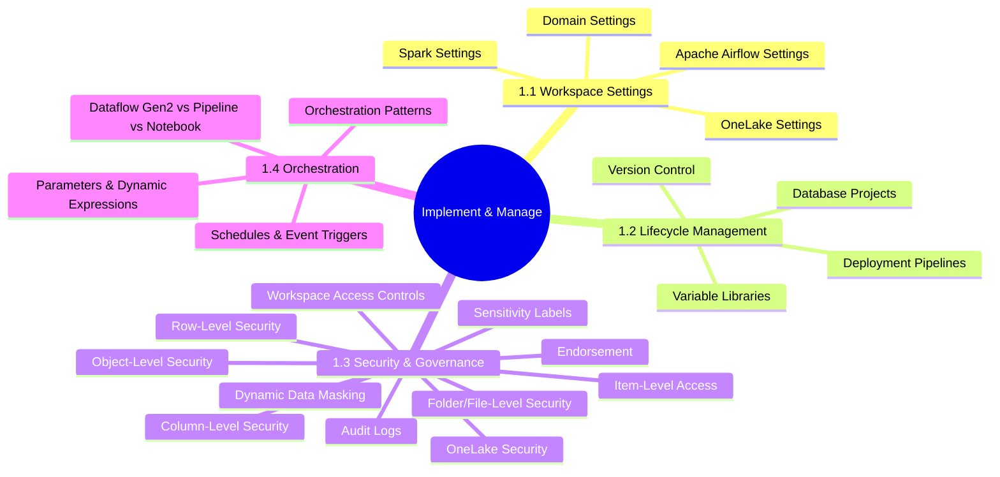
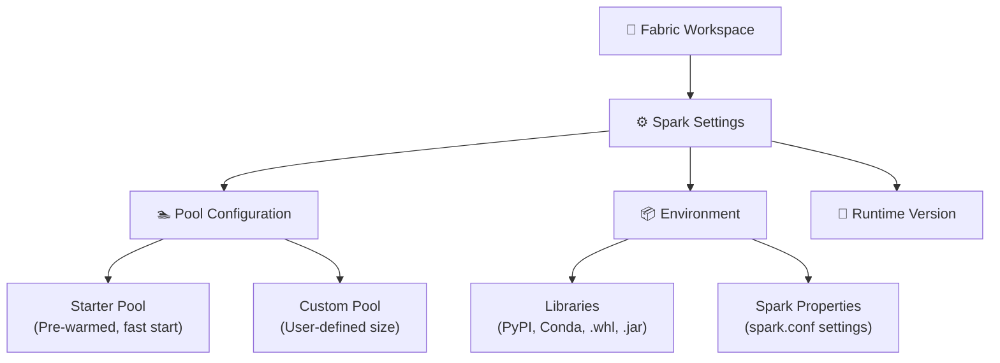
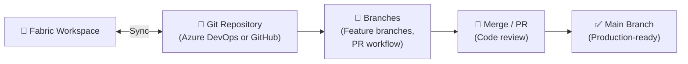
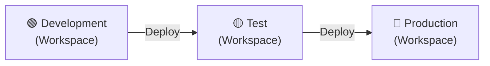
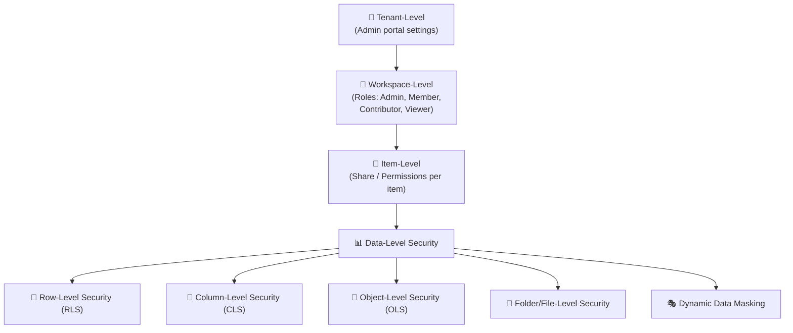
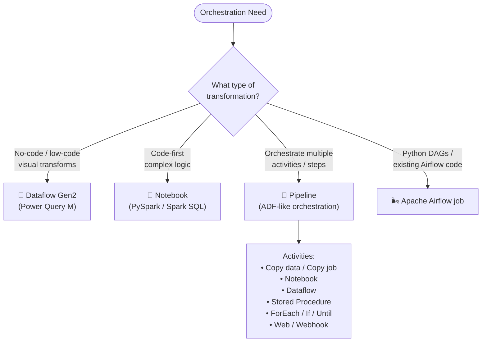
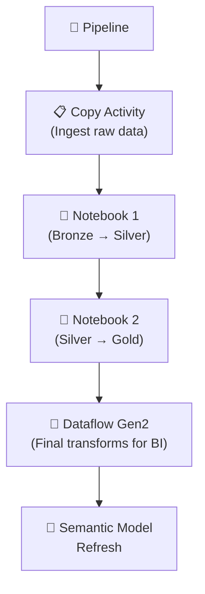

# 01 — Implement & Manage an Analytics Solution
> **Official Exam Weight: 30–35%**
> 📁 [← Back to Home](/dp-700-study-notes/)

---

## 🗺 Domain Overview



---

## ⚙️ 1.1 Configure Microsoft Fabric Workspace Settings

### Spark Workspace Settings

| Setting | Description | Impact |
|---------|-------------|--------|
| **Default runtime** | Spark runtime version (e.g., Runtime 1.2, 1.3) | Determines Spark, Python, R, Delta Lake versions |
| **Starter pools** | Pre-warmed Spark pools for fast start (best-effort) | Sessions typically start in seconds instead of ~3 min |
| **Custom pools** | Configure node size, autoscale, dynamic allocation | Control compute for specific workloads |
| **Custom live pools** | Custom pools kept hydrated during a scheduled window, with environment libraries pre-installed | Predictable ~5 sec session start for scheduled / latency-sensitive jobs |
| **Environment** | Attach libraries, Spark properties, resource files | Consistent dependencies across notebooks |
| **Resource profile** | Predefined Spark/Delta config set (`spark.fabric.resourceProfile`) | Tunes write vs read behaviour, incl. whether V-Order is on |
| **Native execution engine** | Hardware-accelerated Spark execution | Up to 4x faster for supported operations |
| **High concurrency mode** | Share Spark sessions across notebooks | Saves CU consumption when multiple users work simultaneously |
| **Automatic log retention** | Spark logs and event log retention | Debugging and monitoring |

**Resource profiles:**

| Profile | Optimized for | V-Order |
|---------|--------------|---------|
| **`writeHeavy`** *(default for new workspaces)* | Ingestion, ETL, streaming writes | ❌ Disabled |
| **`readHeavyForSpark`** | Frequent Spark reads, interactive queries | ❌ Disabled (Optimize Write on) |
| **`readHeavyForPBI`** | Power BI Direct Lake queries on Delta tables | ✅ Enabled |
| **`custom`** | Fully user-defined Spark configs | User-defined |

```python
# Override the workspace/environment profile for this session
spark.conf.set("spark.fabric.resourceProfile", "readHeavyForPBI")
```



> **Exam Caveat ⚠️:**
> - **Starter pools** and **custom pools** are billed only while a Spark session is active — idle pool time is **not** billed
> - Starter pools are **best-effort** — for guaranteed fast starts on scheduled jobs, use a **custom live pool**
> - Creating custom pools requires the workspace **Admin** role (plus capacity admin permission to size them)
> - New workspaces default to the **`writeHeavy`** resource profile, so **V-Order is off by default** — switch to `readHeavyForPBI` for Direct Lake–heavy tables
> - **Environments** can be shared across multiple notebooks within a workspace
> - The **native execution engine** does not support all Spark operations — unsupported ops fall back to standard Spark

---

### Domain Workspace Settings

**Domains** in Fabric are a way to **group workspaces** by business area (e.g., Finance, Marketing, Engineering).

| Feature | Description |
|---------|-------------|
| **Domain assignment** | Assign a workspace to a specific domain |
| **Domain roles** | Domain admins, domain contributors |
| **Data governance** | Policies and endorsement can be applied at domain level |
| **Discovery** | Users can discover workspaces within their domain in the data hub |

---

### OneLake Workspace Settings

| Setting | Scope | Description |
|---------|-------|-------------|
| **Shortcut cache** | Workspace (OneLake tab) | Caches files read through external shortcuts to cut egress cost and latency. Retention **1–28 days** (reset on each access); files > 1 GB aren't cached; **Reset cache** clears it |
| **Users can access data stored in OneLake with apps external to Fabric** | **Tenant** (admin portal) | When off, external tools using ADLS Gen2 APIs / OneLake file explorer are blocked; Fabric engines (Spark, SQL) still work |

> **Exam Caveat ⚠️:**
> - Shortcut caching supports **GCS, Amazon S3, S3-compatible, and on-premises data gateway** shortcuts — not ADLS Gen2
> - Blocking external apps is a **tenant** setting, not a workspace one — and it must stay **on** to use shortcuts with OneLake security

---

### Apache Airflow Workspace Settings

**Apache Airflow jobs** run Python DAGs on a managed Airflow runtime inside Fabric. Configure the default runtime in **Workspace settings → Data Factory → Apache Airflow runtime settings**.

| Property | Starter Pool *(default)* | Custom Pool |
|----------|-------------------------|-------------|
| **Startup** | Instant runtime | Created in a stopped state, then always on |
| **Idle behaviour** | Auto-shutdown after **20 min** of inactivity — no idle cost | **Always on** until manually paused — constant base cost |
| **Size** | Fixed (Large) | **Small** or **Large** compute nodes, **extra nodes** (≈3 more workers each), **autoscale** |
| **Base CU** | 10 CU (Large) | Small **5 CU** / Large **10 CU** (recommended minimum F8 / F16) |
| **Best for** | Development, testing, infrequent jobs | **Production** — Airflow scheduler runs 24/7 |

> **Exam Caveat ⚠️:**
> - Each Apache Airflow job gets its **own isolated pool** — pools aren't shared between jobs
> - If the workspace setting **"Customize compute configurations for items"** is off, every Airflow job uses the **starter pool**
> - Need DAGs to run on an Airflow schedule unattended? → **Custom pool** (a starter pool shuts down when idle)

---

## 🔄 1.2 Implement Lifecycle Management in Fabric

### Version Control (Git Integration)

Fabric supports **Git integration** for version-controlling workspace items.



**Supported Git providers:**

| Provider | Support |
|----------|---------|
| **Azure DevOps** | Supported (cloud only) — Microsoft Entra ID credentials |
| **GitHub** | Supported (cloud only) — personal access token |
| **GitHub Enterprise** | Supported (cloud only) |
| **Other Git / on-prem servers** | Not supported natively |

**Items that support Git integration (data engineering highlights):**

| Area | Items |
|------|-------|
| Data Engineering | Notebooks, Spark Job Definitions, Lakehouses (metadata), Environments, User Data Functions, GraphQL |
| Data Factory | Pipelines, Dataflow Gen2, Copy job, Mirrored databases, Apache Airflow jobs *(preview)* |
| Data Warehouse / Databases | Warehouses, SQL databases |
| Real-Time Intelligence | Eventhouses, KQL databases, KQL querysets, Eventstreams, Real-Time Dashboards, Activator |
| Power BI | Semantic models, Reports *(preview)* |
| CI/CD | Variable libraries |

*Full, current list: [Git integration — supported items](https://learn.microsoft.com/fabric/cicd/git-integration/intro-to-git-integration#supported-items).*

> **Exam Caveat ⚠️:**
> - Git integration syncs **item definitions** (metadata), not the **data** itself
> - Each workspace connects to **one branch** at a time — you switch branches at workspace level, or **branch out** to a new feature workspace
> - Unsupported items in a connected workspace are **ignored**, not deleted
> - Conflicts must be resolved before syncing

---

### Database Projects

**Database projects** provide a **code-first, schema-as-code** approach for managing Warehouse schemas.

| Feature | Description |
|---------|-------------|
| **SQL project** | Version-controlled set of SQL scripts defining schema |
| **Schema compare** | Compare project schema vs deployed warehouse |
| **Publish** | Deploy schema changes from project to warehouse |
| **IDE support** | VS Code with SQL Database Projects extension |

---

### Deployment Pipelines

Deployment pipelines enable **CI/CD for Fabric** — promoting items across environments.



| Feature | Description |
|---------|-------------|
| **Stages** | Up to 10 stages (typically: Dev → Test → Prod) |
| **Deployment rules** | Override data sources, parameters per stage |
| **Selective deployment** | Deploy individual items or all items |
| **Auto-binding** | Deployed items maintain relationships |
| **Comparison view** | See differences between stages before deploying |

> **Exam Caveat ⚠️:**
> - Deployment pipelines deploy **item definitions**, not data
> - You need **at least Contributor** on both source and target workspaces
> - Deployment pipelines and Git integration **can be used together** — Git for code versioning, pipelines for environment promotion

---

### Variable Libraries

A **variable library** is a workspace item that holds environment-specific values (connection strings, lakehouse IDs, file paths) **outside** item definitions, with one **value set** per stage.

| Feature | Description |
|---------|-------------|
| **Value sets** | Dev / Test / Prod values for the same variables; exactly **one active value set per workspace** |
| **Consumers** | Pipelines, Lakehouse shortcuts, Notebooks (`notebookutils.variableLibrary`), Dataflow Gen2 (CI/CD), Copy job, User data functions, Eventstream |
| **CI/CD** | Git-tracked and deployable; deployment pipelines can activate the right value set per stage — the active set itself isn't overwritten by deploys |

> **Exam Caveat ⚠️:** Prefer **variable libraries** over hardcoded values or per-item deployment rules when the same items must point at different sources in each stage.

---

## 🔒 1.3 Configure Security & Governance

### Security Layers in Fabric



---

### Workspace-Level Access Controls

| Role | Permissions |
|------|------------|
| **Admin** | Full control — manage settings, members, delete workspace |
| **Member** | Create, edit, delete items; share items; cannot manage workspace settings |
| **Contributor** | Create, edit, delete items; cannot share or manage members |
| **Viewer** | View items only; cannot edit, create, or delete |

> **Exam Caveat ⚠️:** Workspace **Viewer** role does not automatically grant access to the underlying **data** — additional item-level or data-level permissions may be needed.

---

### Item-Level Access Controls

You can share individual Fabric items (Lakehouse, Warehouse, Report, etc.) with specific users, granting:

| Permission | What It Grants |
|-----------|---------------|
| **Read** | View item metadata and content |
| **ReadAll** | Read all data in the item (bypasses data-level security for some items) |
| **ReadData** | Read data via SQL (Warehouse, SQL Analytics Endpoint) |
| **Write** | Edit the item |
| **Reshare** | Share the item with others |

---

### Row-Level Security (RLS)

RLS restricts **which rows** a user can see based on filters.

**Where RLS is supported:**

| Item | RLS Method |
|------|-----------|
| **Warehouse** | T-SQL `CREATE SECURITY POLICY` + `FUNCTION` |
| **SQL Analytics Endpoint** | Same as Warehouse |
| **Semantic Model** | DAX filter expressions in Power BI |
| **Lakehouse (via SQL)** | Via SQL Analytics Endpoint |
| **Lakehouse (all engines)** | **OneLake security** role with a row filter (SQL predicate) on the Delta table |

```sql
-- Example: RLS in a Fabric Warehouse
CREATE FUNCTION dbo.fn_SecurityPredicate(@Region AS NVARCHAR(50))
    RETURNS TABLE
    WITH SCHEMABINDING
AS
    RETURN SELECT 1 AS result
    WHERE @Region = USER_NAME()
    OR USER_NAME() = 'admin@contoso.com';

CREATE SECURITY POLICY RegionFilter
    ADD FILTER PREDICATE dbo.fn_SecurityPredicate(Region) ON dbo.Sales;
```

---

### Column-Level Security (CLS)

CLS restricts **which columns** a user can see.

```sql
-- Example: Grant SELECT on specific columns only
GRANT SELECT ON dbo.Employees(Name, Department, Title) TO [analyst@contoso.com];
-- The Salary column is NOT included — the user cannot see it
```

> **Exam Caveat ⚠️:** CLS is supported in **Warehouse** and **SQL Analytics Endpoint** via T-SQL `GRANT`/`DENY` on specific columns, and on Lakehouse tables via **OneLake security** (set columns to *Hide* in a role) — the latter applies across Spark, SQL, and Direct Lake.

---

### Object-Level Security (OLS)

OLS controls access to **entire objects** (tables, views, columns, folders).

| Where | How |
|-------|-----|
| **Warehouse / SQL Analytics Endpoint** | T-SQL `GRANT` / `DENY` / `REVOKE` on tables, views, schemas |
| **OneLake security** (Lakehouse) | Role grants on specific tables, schemas, or folders |
| **Semantic Model** (Power BI) | OLS roles with `none` permission — objects become completely invisible |

---

### Folder/File-Level Security (OneLake)

Folder/file-level access in a Lakehouse is implemented with **OneLake security roles** (see [OneLake Security](#onelake-security) below).

| Feature | Description |
|---------|-------------|
| **Scope** | Folders and files (Files section), tables and schemas (Tables section — tables are folders too) |
| **Inheritance** | Permissions granted on a folder apply to all its files and subfolders |
| **Traversal** | Access to a child lets the user list/traverse its parents — but not siblings |

---

### Dynamic Data Masking (DDM)

DDM **masks data at query time** without changing stored data.

| Mask Function | Effect | Example |
|--------------|--------|---------|
| **Default** | Full mask based on data type | `XXXX` for strings, `0` for numbers |
| **Email** | Shows first char + `XXX@XXX.com` | `mXXX@XXXX.com` |
| **Partial** | Shows prefix + padding + suffix | `Cus-XXXX-er` |
| **Random** | Random number in specified range | `42` (random) |

```sql
-- Example: Apply dynamic data masking in Warehouse
ALTER TABLE dbo.Customers
ALTER COLUMN Email ADD MASKED WITH (FUNCTION = 'email()');

ALTER TABLE dbo.Customers
ALTER COLUMN CreditCard ADD MASKED WITH (FUNCTION = 'partial(0,"XXXX-XXXX-XXXX-",4)');
```

> **Exam Caveat ⚠️:** Users with `UNMASK` permission can see the original data. DDM is **not** a security boundary for users with elevated database permissions.

---

### Sensitivity Labels

| Feature | Description |
|---------|-------------|
| **Source** | Microsoft Purview Information Protection |
| **Apply to** | Any Fabric item (Lakehouse, Warehouse, Report, etc.) |
| **Labels** | E.g., Public, General, Confidential, Highly Confidential |
| **Inheritance** | Labels propagate downstream (e.g., Lakehouse → Report) |
| **Encryption** | Can enforce encryption on exported data |

---

### Item Endorsement

| Endorsement Level | Meaning | Who Can Apply |
|-------------------|---------|---------------|
| **Promoted** | Recommended for use | Item owner, workspace member |
| **Certified** | Meets organization's quality standards | Designated certifiers (admin-defined) |
| **Master data** | Authoritative source of truth | Designated certifiers |

---

### Audit Logs

| Feature | Description |
|---------|-------------|
| **Source** | Microsoft 365 Unified Audit Log |
| **Access** | Microsoft Purview compliance portal |
| **Events** | Item creation, deletion, access, sharing, data access |
| **Retention** | Audit (Standard): **180 days**; longer with Audit (Premium) retention policies (up to 10 years) |
| **Fabric activity log** | Fabric/Power BI-only log for Fabric admins via REST API — **30 days** |
| **API** | Office 365 Management Activity API for programmatic access / SIEM export |

> **Exam Caveat ⚠️:** Accessing the unified audit log requires an **Audit Logs** role (Purview / Exchange Online) — a Fabric workspace role is not enough.

---

### OneLake Security

**OneLake security** is the data-plane role model for data in OneLake, enforced consistently across Spark, the SQL analytics endpoint (user's identity mode), Direct Lake on OneLake semantic models, and other engines.

| Component | Detail |
|-----------|--------|
| **Who creates roles** | Workspace **Admin** or **Member** (via *Manage OneLake security* on the item) |
| **Permissions** | **Read** or **ReadWrite** (ReadWrite = create/edit/delete folders, tables, files, shortcuts via Spark / OneLake APIs) |
| **Data in role** | Tables, schemas, or folders — plus **row-level** and **column-level** security on Delta tables |
| **Members** | Entra users, groups, service principals / managed identities |
| **Default role** | `DefaultReader` gives anyone with **ReadAll** access to all lakehouse data — edit or delete it to lock down |
| **Supported items** | Lakehouse (Read, ReadWrite), mirrored databases & mirrored catalogs (Read) |
| **Encryption** | At rest with Microsoft-managed keys by default; **customer-managed keys** optional per workspace |

> **Exam Caveat ⚠️:**
> - OneLake security roles only restrict **Viewers** / users with item **Read** — workspace **Admin, Member, Contributor** always have full read/write on the data
> - Roles are **grant-only** (no deny). Multiple roles combine as a **union**; within one role, OLS ∩ RLS ∩ CLS
> - A role with **ReadWrite** can't contain RLS or CLS
> - RLS and CLS for the same table must live in the **same role** — combining an RLS role with a separate CLS role causes query errors
> - Shortcut security: OneLake-to-OneLake shortcuts use the **calling user's identity**; external shortcuts use the **connection credential**, with OneLake security applied on top

---

## 🔀 1.4 Orchestrate Processes

### Choosing the Right Orchestration Tool



### Comparison Table

| Feature | Dataflow Gen2 | Notebook | Pipeline |
|---------|--------------|----------|---------------|
| **Persona** | Citizen developer, analyst | Data engineer, data scientist | Data engineer, orchestrator |
| **Language** | M (Power Query) | PySpark, Spark SQL, R | Visual designer + expressions |
| **Code required** | No (visual UI) | Yes | Minimal (visual + expressions) |
| **Best for** | Simple transforms, mashups | Complex transforms, ML, large data | Orchestrating multi-step workflows |
| **Data movement** | Built-in connectors (150+) | Read/write via Spark | Copy activity (90+ connectors) |
| **Scalability** | Medium | High (Spark cluster) | Depends on activity type |
| **Triggers** | Schedule, pipeline | Schedule, pipeline, on-demand | Schedule (incl. interval), event-based |

> **Exam Caveat ⚠️:**
> - **Dataflow Gen2** is the replacement for Dataflow Gen1 (Power BI Dataflows) — Gen2 can write to Lakehouse, Warehouse, KQL Database
> - **Pipelines** can call Notebooks, Dataflow Gen2, and Copy jobs as activities — use pipelines as the orchestration layer
> - Pure data movement (bulk, incremental, or CDC) with no orchestration logic? → **Copy job** is simpler than a pipeline with a Copy activity
> - A **Notebook** can also orchestrate by calling other notebooks via `%run`, `notebookutils.notebook.run()`, or `notebookutils.notebook.runMultiple()` (parallel / DAG) — `mssparkutils` is the legacy name of `notebookutils`

---

### Schedules and Event-Based Triggers

| Trigger Type | Description | Use Case |
|-------------|-------------|----------|
| **Schedule** | Run at specific times or on a fixed interval (every *n* minutes/hours, daily, weekly…) | Daily/hourly ETL jobs; ADF "tumbling window" workloads map to **interval schedules** |
| **Event-based (storage)** | React to **OneLake** or **Azure Blob Storage** file events (created, deleted…) | Process files as they land |
| **Event-based (job / workspace)** | React to Fabric **job events** (item run succeeded/failed) or **workspace events** | Chain items across workspaces, react to failures |
| **On-demand** | Manual run or REST API | Ad-hoc runs, testing |

> **Exam Caveat ⚠️:**
> - Event triggers are built on **Activator** (plus an Eventstream for the event source) — the trigger is saved as a **Reflex** item in the workspace
> - Storage-event triggers expose the **file name and folder path** as trigger parameters you can use in pipeline expressions
> - Schedules can send **failure notifications** to users/groups (Schedule → Failure notifications)

---

### Orchestration Patterns with Notebooks and Pipelines

#### Parameters and Dynamic Expressions

**Pipeline parameters:**

```json
{
  "sourcePath": "@pipeline().parameters.InputFolder",
  "fileName": "@concat(pipeline().parameters.Prefix, '_', formatDateTime(utcnow(), 'yyyyMMdd'), '.parquet')"
}
```

**Notebook parameters (parameter cell, overridden by the pipeline Notebook activity or `notebookutils.notebook.run`):**

```python
# Notebook parameter cell (toggle "Mark cell as parameters")
input_path = "abfss://workspace@onelake.dfs.fabric.microsoft.com/lakehouse.Lakehouse/Files/raw/"
output_table = "cleaned_sales"
load_date = "2026-04-08"
```

**Notebook orchestration from code:**

```python
# Run one child notebook (timeout in seconds, parameters dict) and capture its exit value
result = notebookutils.notebook.run("Bronze_to_Silver", 600, {"load_date": "2026-10-13"})

# Run several notebooks in parallel / as a DAG inside one Spark session
dag = {
    "activities": [
        {"name": "silver_sales", "path": "Bronze_to_Silver_Sales"},
        {"name": "silver_customers", "path": "Bronze_to_Silver_Customers"},
        {"name": "gold", "path": "Silver_to_Gold", "dependencies": ["silver_sales", "silver_customers"]}
    ]
}
notebookutils.notebook.validateDAG(dag)
notebookutils.notebook.runMultiple(dag)
```

> **Exam Caveat ⚠️:** `runMultiple()` child notebooks **share the parent's Spark session** compute — concurrency is bounded by driver cores. Use a child's `notebookutils.notebook.exit(value)` to return a (string) result.

**Common orchestration patterns:**



---

## 📊 Quick-Reference Scenario Table

| Scenario | Requirement | Answer |
|----------|-------------|--------|
| Promote items from Dev → Test → Prod | Environment promotion | **Deployment Pipelines** |
| Version-control notebook code | Source control | **Git Integration (Azure DevOps / GitHub)** |
| Restrict users to see only their region's data | Data filtering | **Row-Level Security (RLS)** |
| Hide salary column from analysts | Column restriction | **Column-Level Security (CLS)** |
| Mask email addresses in query results | Data masking | **Dynamic Data Masking (DDM)** |
| Orchestrate Copy → Notebook → Dataflow sequence | Multi-step workflow | **Pipeline** |
| No-code transform CSV to Lakehouse table | Visual ETL | **Dataflow Gen2** |
| Complex PySpark transform on large dataset | Code-first ETL | **Notebook** |
| Run several notebooks in parallel with dependencies | Code-first orchestration | **`notebookutils.notebook.runMultiple()`** |
| Trigger pipeline when file lands in OneLake | Event-driven | **Storage event trigger (Activator)** |
| Track who accessed what data | Audit trail | **Microsoft Purview unified audit log** |
| Mark a dataset as trusted and organization-approved | Data quality signal | **Certified endorsement** |
| Control Spark cluster size for a workspace | Compute management | **Custom pool in Spark settings** |
| Guaranteed ~5 sec Spark start for a scheduled job | Predictable startup | **Custom live pool** |
| Faster Direct Lake reads on new Delta tables | V-Order needed | **`readHeavyForPBI` resource profile** |
| Airflow DAGs must run 24/7 on schedule in production | Always-on Airflow | **Apache Airflow custom pool** |
| Viewer must see only some lakehouse tables/rows in Spark + SQL | Data-plane security | **OneLake security role (OLS + RLS)** |
| Same items need different source IDs in Dev/Test/Prod | Stage-specific config | **Variable library (value sets)** |
| Schema-as-code for Warehouse | Version-controlled schema | **Database Projects** |

---

[← 00 — Fabric Prerequisites](/dp-700-study-notes/00-fabric-prerequisites/) | [02 — Ingest & Transform Data →](/dp-700-study-notes/02-ingest-transform-data/)