# 02 — Ingest & Transform Data
> **Official Exam Weight: 30–35%**
> 📁 [← Back to Home](/dp-700-study-notes/)

---

## 🗺 Domain Overview

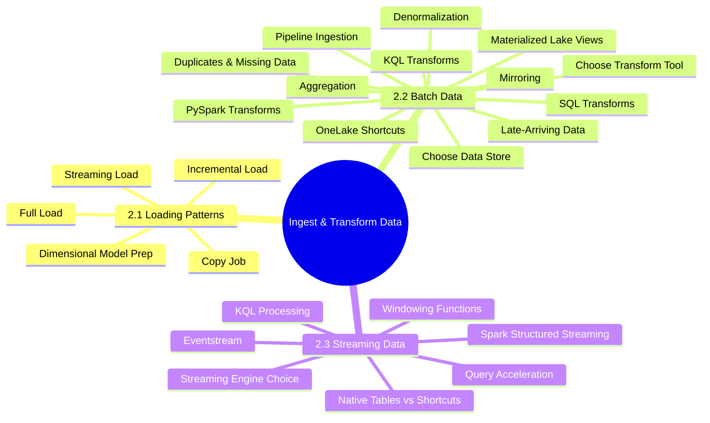

---

## 📥 2.1 Design & Implement Loading Patterns

### Full Load vs Incremental Load

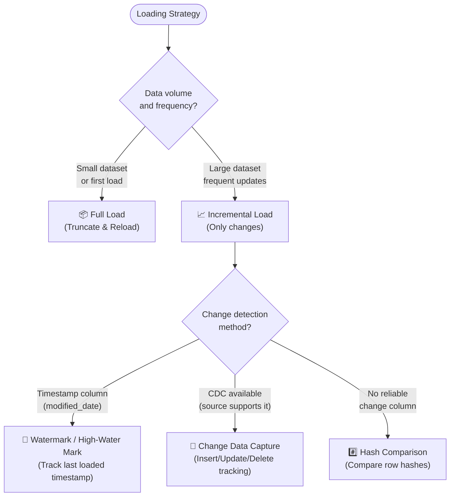

### Comparison Table

| Aspect | Full Load | Incremental Load |
|--------|-----------|-----------------|
| **Data transferred** | Entire dataset every run | Only new/changed rows |
| **Complexity** | Simple | More complex (change detection) |
| **Duration** | Longer (proportional to total size) | Shorter (proportional to changes) |
| **Target operation** | Truncate + insert | Merge / upsert / append |
| **Idempotent** | Yes (always same result) | Requires careful design |
| **Best for** | Small reference tables, initial loads | Large fact tables, frequent updates |

> **Exam Caveat ⚠️:**
> - **Watermark/high-water mark** is the simplest incremental pattern — requires a reliable `modified_date` or `version` column in the source
> - **MERGE** (Delta Lake) is the preferred method for upserts in Fabric Lakehouses
> - For a **read-only, near real-time replica** of Azure SQL / SQL Server, use **Mirroring**; to land CDC changes into **your own** tables (merge, SCD Type 2), use a **Copy job** with CDC

---

### Copy Job — Built-in Full & Incremental Loads

A **Copy job** moves data from many sources to many destinations **without building a pipeline**, and tracks incremental state for you.

| Capability | Options |
|-----------|---------|
| **Copy mode** | **Full copy** (every run) or **Incremental copy** (first run full, then only changes) |
| **Incremental method** | **Watermark** column (ROWVERSION, datetime, date, integer…) or **CDC** (when enabled on the source — also captures **deletes**) |
| **Update method** | **Append** (default), **Overwrite**, **Merge** (upsert on key), **SCD Type 2** |
| **Extras** | Custom source queries, column mapping, auto-create/truncate destination tables, scheduling |
| **Orchestration** | Runs standalone on a schedule, or inside a pipeline via the **Copy job activity** |

> **Exam Caveat ⚠️:**
> - A failed incremental run **resumes from the last successful run** — the watermark/CDC state isn't advanced on failure
> - Watermark-based incremental copy only sees **inserts and updates**; you need **CDC** to replicate **deletes**
> - Microsoft's guidance: **Copy job** for bronze ingestion, **Mirroring** for read-only replicas, **pipelines** when you need orchestration or metadata-driven copy

---

### Preparing Data for a Dimensional Model

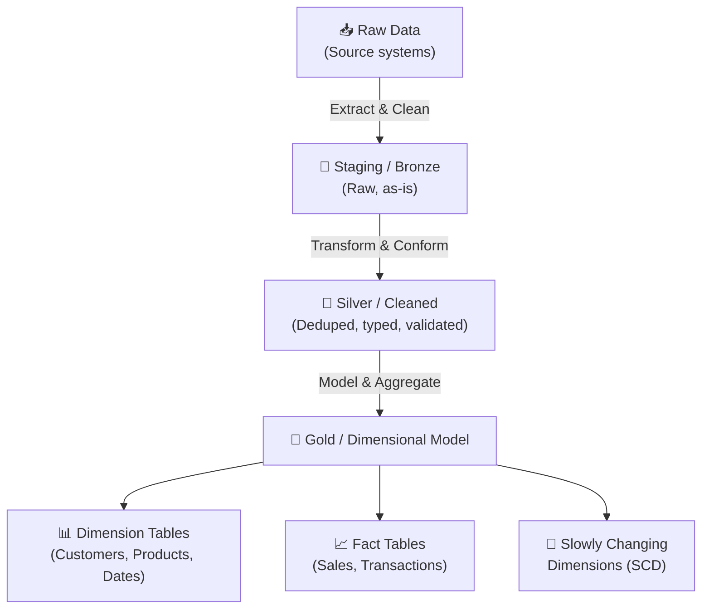

**Slowly Changing Dimensions (SCD):**

| Type | Name | Behaviour | Implementation |
|------|------|-----------|----------------|
| **SCD Type 1** | Overwrite | Replace old value with new | Simple UPDATE |
| **SCD Type 2** | History | Keep full history with valid_from/valid_to | Add new row, close old row |
| **SCD Type 3** | Previous value | Keep current + previous value | Add previous_value column |

> **Exam Caveat ⚠️:** SCD Type 2 is the most common exam scenario — know how to implement it with Delta Lake MERGE operations including `valid_from`, `valid_to`, and `is_current` columns. (A Copy job can also write SCD Type 2 directly when the source has CDC.)

---

### Streaming Data Loading Patterns

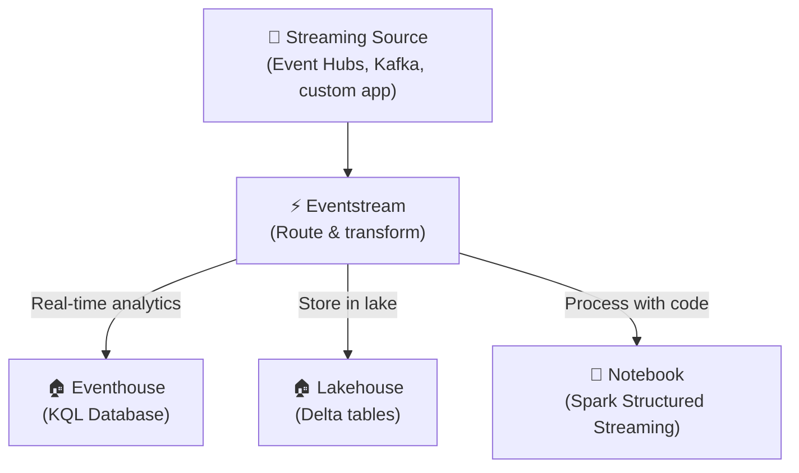

---

## 🔄 2.2 Ingest & Transform Batch Data

### Choosing an Appropriate Data Store

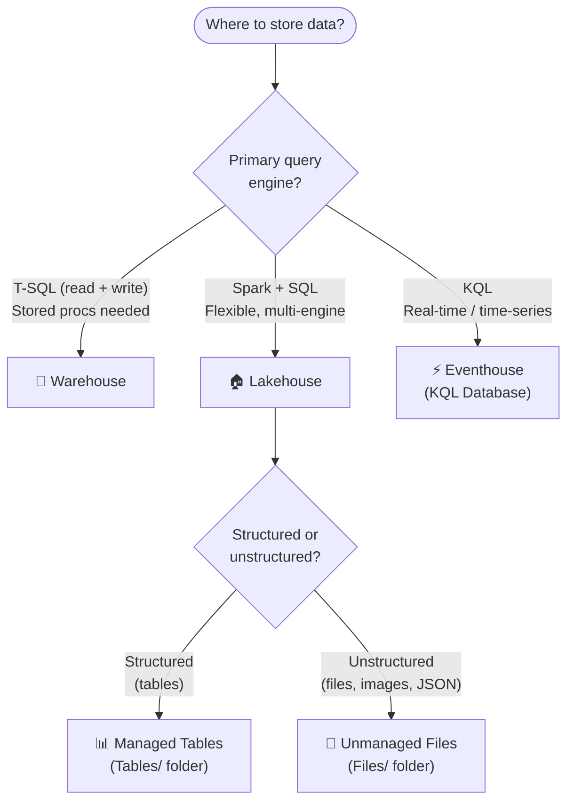

---

### Choosing the Right Transform Tool

| Need | Tool | Language |
|------|------|---------|
| No-code visual transforms, 150+ connectors | **Dataflow Gen2** | M (Power Query) |
| Complex transforms on large data | **Notebook** | PySpark / Spark SQL |
| Real-time analytics transforms | **KQL** | Kusto Query Language |
| SQL-based transforms in Warehouse | **T-SQL** | T-SQL |
| Simple SQL on Lakehouse tables | **Notebook (`%%sql`)** | Spark SQL |
| Declarative, auto-refreshing medallion layers in a Lakehouse | **Materialized lake views** | Spark SQL (or PySpark) |

**Dataflow Gen2 performance features** (know which one fits):

| Feature | Use when |
|---------|----------|
| **Fast Copy** | High-volume extract-load from a supported source with little or no transformation (copy engine instead of mashup engine) |
| **Staging** (per query) | Land data first in the staging Lakehouse/Warehouse, then transform — an ELT pattern for heavy joins/aggregations |
| **Modern Evaluator** | Faster evaluation of non-foldable shaping steps (default in new Dataflow Gen2 with CI/CD) |
| **Partitioned compute** *(preview)* | Many files / partitioned sources processed in parallel (ADLS Gen2, Folder, Blob) — finishes sooner, not cheaper |

---

### Materialized Lake Views

A **materialized lake view (MLV)** is a Spark SQL (`CREATE MATERIALIZED LAKE VIEW`) or PySpark definition whose result Fabric persists as a Delta table and keeps refreshed.

```sql
CREATE MATERIALIZED LAKE VIEW silver.clean_orders
(
    CONSTRAINT valid_amount CHECK (amount > 0) ON MISMATCH DROP
)
AS
SELECT order_id, customer_id, CAST(order_date AS DATE) AS order_date, amount
FROM bronze.orders;
```

| Feature | Detail |
|---------|--------|
| **Refresh** | Fabric picks **incremental**, **full**, or **skip** — incremental requires **Delta change data feed** on the sources |
| **Data quality** | `CONSTRAINT … CHECK … ON MISMATCH DROP` or `FAIL` |
| **Dependencies** | Lineage across MLVs; refresh runs in dependency order |
| **File ingestion** | Can read CSV/Parquet files directly from OneLake as a bronze layer |

> **Exam Caveat ⚠️:** MLVs suit SQL-expressible medallion steps. For ML, API calls, or complex Python logic, use notebooks; for sub-second streaming, use Real-Time Intelligence.

---

### OneLake Shortcuts

Shortcuts provide **virtual access** to data without copying.

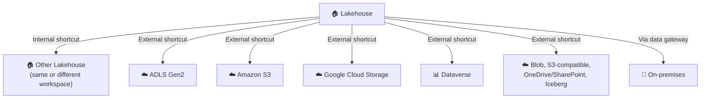

| Shortcut Type | Data Copied? | Latency | Security |
|--------------|-------------|---------|----------|
| **Internal (OneLake → OneLake)** | No | Low | Calling user's identity + OneLake permissions |
| **External (ADLS Gen2, Blob, S3, S3-compatible, GCS)** | No | Higher (cross-service) | Connection credential + OneLake permissions |
| **Dataverse / OneDrive & SharePoint** | No | Medium | Connection credential + OneLake permissions |
| **On-premises (gateway)** | No | Depends on gateway/network | Gateway connection + OneLake permissions |

**Create and manage shortcuts:**

| Task | Detail |
|------|--------|
| **Create** | Requires **Write** on the item holding the shortcut (or OneLake security ReadWrite) **and** Read on the target |
| **Where** | Under **Tables** (Delta tables → visible to SQL endpoint & Direct Lake) or under **Files** (any format) |
| **Connections** | External shortcuts bind to a **cloud connection** — you need permission on the connection to reuse it |
| **Caching** | Workspace OneLake setting; 1–28-day retention, for GCS/S3/S3-compatible/gateway shortcuts |
| **Transformations** | Shortcut **file transformations** (CSV/Parquet/JSON → synced Delta table) and **AI transformations** for text files |
| **Automation** | REST API, and **variable libraries** to change shortcut targets per stage |

> **Exam Caveat ⚠️:**
> - Shortcuts appear as regular folders in the Lakehouse — Spark and SQL can query them transparently
> - External shortcuts have **higher latency** than native OneLake data — consider caching, or mirroring/copying for performance-critical queries
> - Shortcut data is **not included** in OPTIMIZE or VACUUM operations — it's managed at the source
> - Deleting a shortcut removes the **pointer**, not the target data

---

### Mirroring

Mirroring makes data from another system available in OneLake, kept up to date in **near real time**, with no ETL pipelines.

| Mirroring type | How it works | Sources |
|---------------|-------------|---------|
| **Database mirroring** | Continuously **replicates** data into OneLake as Delta tables | Azure SQL Database, Azure SQL Managed Instance, Azure Cosmos DB, Azure Database for PostgreSQL, SQL Server, Snowflake, Google BigQuery, Oracle, SAP, Fabric SQL database *(automatic)*; previews: Azure Database for MySQL, SharePoint List |
| **Metadata mirroring** | Syncs an external **catalog's metadata** and uses **shortcuts** to the data — nothing copied | Azure Databricks (Unity Catalog), Snowflake; preview: Dremio |
| **Open mirroring** | Any app/partner **writes change data** into a mirrored database's landing zone using the open Delta-based format | Custom code, partners (e.g., Striim, Oracle GoldenGate, MongoDB, CData) |

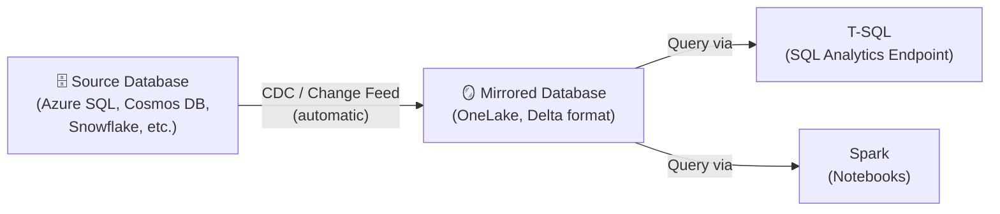

> **Exam Caveat ⚠️:**
> - Mirroring vs Shortcuts: **database mirroring copies data** into OneLake (near real-time CDC), while **shortcuts point to data** without copying
> - Mirrored data is stored in **Delta format**, read-only, and queried through the auto-created **SQL analytics endpoint**, Spark, or Direct Lake
> - Mirroring is **one-way** — changes in OneLake are NOT pushed back to the source
> - Core mirroring compute and storage are **free**; optional **extended capabilities** (Delta change data feed, mirroring views) are paid
> - Source isn't supported? → **Open mirroring** (or a Copy job with CDC)

---

### Ingest Data by Using Pipelines

**Copy Activity** is the primary pipeline activity for data ingestion.

| Feature | Description |
|---------|-------------|
| **Source connectors** | 50+ source connectors (databases, files, SaaS apps); on-premises via the **on-premises data gateway**, private networks via the **VNet data gateway** |
| **Destination** | 40+ destinations, incl. Lakehouse (Tables or Files), Warehouse, KQL Database, SQL database |
| **Format support** | Parquet, CSV, JSON, ORC, Avro, Delta |
| **Parallelism** | Configurable degree of copy parallelism |
| **Staging** | Optional staging for large or format-converting copies |

**Other ingestion activities:**

| Activity | Use |
|----------|-----|
| **Copy job activity** | Run an existing Copy job (with its incremental/CDC state) as a step in a pipeline |
| **Lookup + ForEach + Copy** | **Metadata-driven** ingestion — read a control table, copy each listed table with parameters |
| **Notebook / Dataflow activities** | Ingest with code or Power Query when Copy can't express the logic |

> **Exam Caveat ⚠️:** Watermark-based incremental copy **in a pipeline** means you track the watermark yourself (Lookup old/new watermark → Copy with a filtered query → update the watermark). A **Copy job** manages that state natively.

---

### Transform Data by Using PySpark

#### Common PySpark Patterns

**Read & write Delta tables:**

```python
# Read from Lakehouse table
df = spark.read.format("delta").load("Tables/raw_sales")

# Transform
from pyspark.sql.functions import col, year, month, sum as _sum

df_clean = (df
    .filter(col("amount") > 0)
    .withColumn("year", year("order_date"))
    .withColumn("month", month("order_date"))
    .dropDuplicates(["order_id"])
)

# Write to Lakehouse table
df_clean.write.format("delta").mode("overwrite").saveAsTable("cleaned_sales")
```

**Delta MERGE (upsert):**

```python
from delta.tables import DeltaTable

target = DeltaTable.forName(spark, "gold_customers")

(target.alias("t")
    .merge(df_new.alias("s"), "t.customer_id = s.customer_id")
    .whenMatchedUpdateAll()
    .whenNotMatchedInsertAll()
    .execute()
)
```

**Partitioning:**

```python
# Write partitioned by year and month
df.write.format("delta") \
    .partitionBy("year", "month") \
    .mode("overwrite") \
    .saveAsTable("partitioned_sales")
```

---

### Transform Data by Using SQL (T-SQL)

```sql
-- Create a transformed table in Warehouse
CREATE TABLE gold.monthly_sales AS
SELECT
    YEAR(order_date)  AS sale_year,
    MONTH(order_date) AS sale_month,
    region,
    SUM(amount)       AS total_amount,
    COUNT(*)          AS order_count
FROM staging.raw_sales
WHERE amount > 0
GROUP BY YEAR(order_date), MONTH(order_date), region;
```

**CTAS (CREATE TABLE AS SELECT)** is commonly used in Fabric Warehouses for large transforms.

---

### Transform Data by Using KQL

```kql
// Aggregate events by hour in an Eventhouse
SensorReadings
| where Timestamp > ago(7d)
| summarize AvgTemp = avg(Temperature),
            MaxTemp = max(Temperature),
            ReadingCount = count()
  by bin(Timestamp, 1h), DeviceId
| order by Timestamp desc
```

---

### Denormalize Data

| Pattern | Description | Use Case |
|---------|-------------|----------|
| **Flatten** | Join dimension into fact table | Star schema → flat table for BI |
| **Nest** | Store related data as struct/array | Semi-structured data in Delta |
| **Pre-aggregate** | Compute aggregates ahead of time | Dashboard performance |

---

### Handle Duplicate, Missing, and Late-Arriving Data

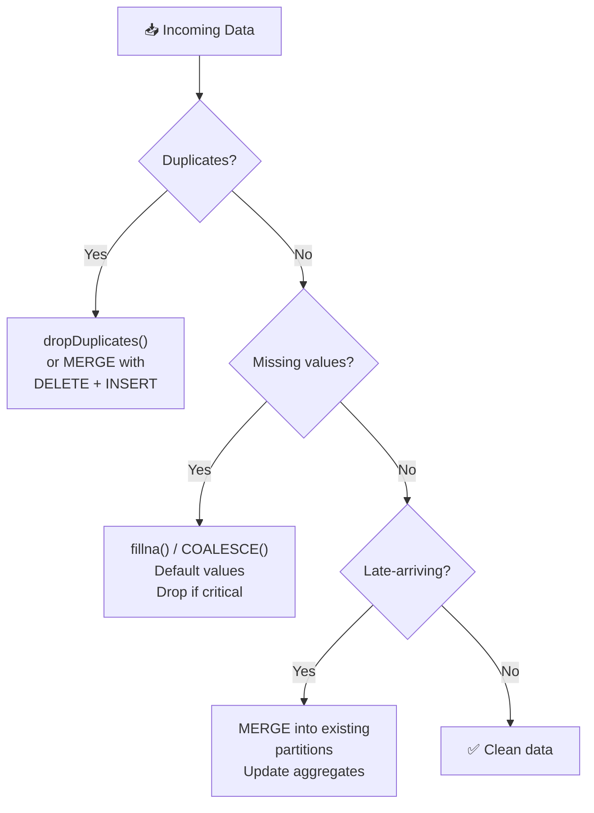

> **Exam Caveat ⚠️:**
> - **Late-arriving data** in streaming scenarios is handled via **watermarks** in Spark Structured Streaming
> - In batch scenarios, use **MERGE** to upsert late-arriving records into the correct partition
> - Always design incremental loads to be **idempotent** — rerunning should produce the same result

---

## ⚡ 2.3 Ingest & Transform Streaming Data

### Choosing an Appropriate Streaming Engine

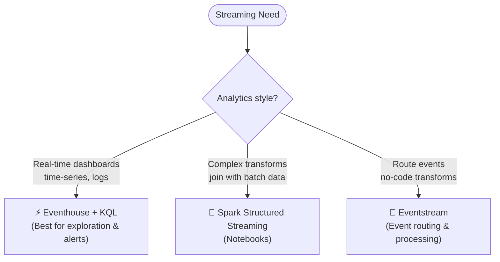

### Comparison

| Feature | Eventstream | Spark Structured Streaming | KQL |
|---------|-------------|---------------------------|-----|
| **Latency** | Seconds | Seconds–minutes | Seconds |
| **Coding** | No-code / low-code | PySpark | KQL queries |
| **Best for** | Event routing, no-code or SQL transforms | Complex joins, ML on streams | Real-time analytics, alerts |
| **Destination** | Eventhouse, Lakehouse, Activator, custom endpoint, derived stream | Lakehouse (Delta) | KQL Database |
| **Windowing** | Tumbling, hopping, sliding (Group by); + session, snapshot (SQL operator) | Tumbling, sliding, session | `bin()` tumbling; sliding/session via KQL functions |

---

### Native Tables vs OneLake Shortcuts in Real-Time Intelligence

| Feature | Native KQL Table | OneLake Shortcut |
|---------|-----------------|-----------------|
| **Data location** | Eventhouse (native storage) | OneLake (external reference) |
| **Ingestion** | Direct ingestion, lowest latency | No ingestion — query in place |
| **Performance** | Fastest KQL queries | Slower (cross-service reads) |
| **Use case** | Hot path — active real-time analytics | Warm/cold path — historical lookups |

**Query acceleration for OneLake shortcuts:**

| Feature | Standard Shortcut | Query-Accelerated Shortcut |
|---------|------------------|---------------------------|
| **Caching** | None | Automatic caching in Eventhouse |
| **Performance** | Slower (reads from OneLake) | Faster (reads from cache) |
| **Freshness** | Real-time | Near real-time (cache refresh interval) |
| **Use case** | Infrequent queries on cold data | Frequent queries on shortcut data |

> **Exam Caveat ⚠️:** **Query acceleration** creates a cached copy of shortcut data in the Eventhouse — it improves performance but adds CU consumption and slight data freshness delay.

---

### Process Data by Using Eventstream

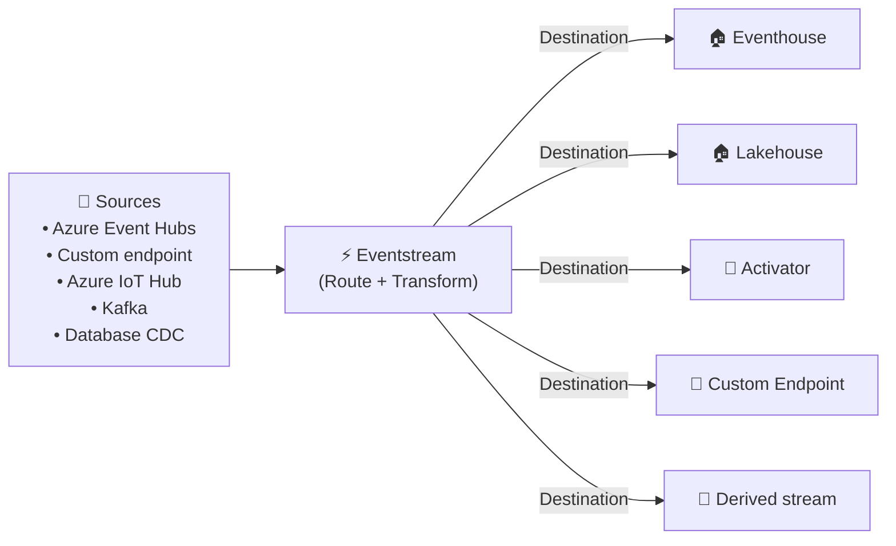

**Eventstream capabilities:**

| Feature | Description |
|---------|-------------|
| **No-code transforms** | Filter, Manage fields, Aggregate, Group by (windowed), Union, Expand, Join |
| **SQL operator** | Write Stream Analytics–style SQL (windowing, aggregations, joins, content-based routing) |
| **Multiple destinations** | Route the same stream to multiple targets; a **derived stream** publishes the transformed stream to the Real-Time hub |
| **Eventhouse ingestion modes** | **Direct ingestion** (raw) or **Event processing before ingestion** (transformed) |
| **Formats** | JSON, CSV, Avro (incl. Confluent Schema Registry); schema-aware Eventstreams *(preview)* |

```sql
-- Eventstream SQL operator: 1-minute tumbling totals per city
SELECT System.Timestamp AS WindowEnd, city, SUM(salesAmount) AS TotalSales
INTO output
FROM input
GROUP BY city, TumblingWindow(minute, 1)
```

> **Exam Caveat ⚠️:**
> - Eventstream has **no Warehouse destination** — land events in a Lakehouse or Eventhouse, then load the Warehouse
> - Only **direct ingestion** supports the extra plain-text formats (e.g., TSV, PSV), and only into Eventhouse — Eventstream can't transform them
> - Eventstream destinations need **Contributor** (or higher) on the destination workspace

---

### Process Data by Using Spark Structured Streaming

```python
# Read a bronze Delta table (e.g., landed by an Eventstream Lakehouse destination) as a stream of changes
df_stream = (spark.readStream
    .format("delta")
    .option("readChangeFeed", "true")
    .table("bronze_events")
)

# Transform
from pyspark.sql.functions import window, avg, count

df_agg = (df_stream
    .withWatermark("event_time", "10 minutes")
    .groupBy(
        window("event_time", "5 minutes"),
        "device_id"
    )
    .agg(
        avg("temperature").alias("avg_temp"),
        count("*").alias("event_count")
    )
)

# Write to Delta table
(df_agg.writeStream
    .format("delta")
    .outputMode("append")
    .option("checkpointLocation", "Files/checkpoints/sensor_agg")
    .toTable("silver_sensor_aggregates")
)
```

> **Exam Caveat ⚠️:**
> - **Watermark** is required for stateful aggregations on streaming data — it tells Spark how long to wait for late data
> - **Checkpoint location** is mandatory for fault-tolerant streaming — stores offset/state between runs
> - Use **`readChangeFeed`** on Delta tables to read changes as a stream (CDC on Delta)

---

### Windowing Functions

| Window Type | Description | Use Case |
|-------------|-------------|----------|
| **Tumbling** | Fixed-size, non-overlapping, contiguous | "Count events per 5-minute block" |
| **Sliding / Hopping** | Fixed-size, overlapping by slide interval | "Average over last 10 min, updated every 2 min" |
| **Session** | Dynamic size, based on activity gaps | "Group user clicks until 30-min inactivity" |

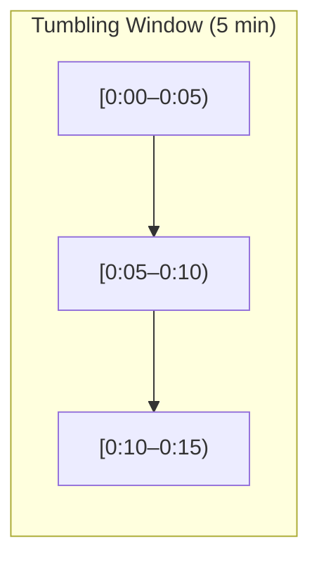

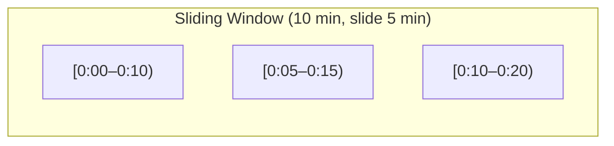

**KQL windowing example:**

```kql
// Tumbling window: events per 5-minute block
SensorReadings
| summarize EventCount = count(), AvgTemp = avg(Temperature)
  by bin(Timestamp, 5m), DeviceId
```

**PySpark windowing example:**

```python
from pyspark.sql.functions import window

df_windowed = (df_stream
    .groupBy(window("event_time", "5 minutes"), "device_id")
    .count()
)
```

---

## 📊 Quick-Reference Scenario Table

| Scenario | Requirement | Answer |
|----------|-------------|--------|
| Copy data from Azure SQL to Lakehouse as a step in an orchestrated workflow | Batch ingestion | **Pipeline Copy Activity** |
| Incremental / CDC copy into Lakehouse tables with no pipeline to build | Managed incremental state | **Copy job** |
| Replicate source deletes as well as inserts/updates | Change capture | **Copy job with CDC** (not watermark) |
| Declarative bronze→silver→gold SQL with data-quality rules | Auto-refreshing medallion | **Materialized lake views** |
| Eventstream must aggregate with a session window or join two streams | Code-first stream processing | **Eventstream SQL operator** |
| Mirror a database Fabric doesn't support natively | Custom replication | **Open mirroring** |
| No-code transform CSV → Lakehouse table | Visual ETL | **Dataflow Gen2** |
| Complex PySpark join on 100M+ rows | Code-first large-scale | **Notebook** |
| Access ADLS Gen2 data without copying | Virtual access | **OneLake Shortcut** |
| Near real-time replica of Azure SQL | Automatic CDC | **Mirroring** |
| Process IoT events in real-time | Stream routing | **Eventstream → Eventhouse** |
| 5-minute tumbling window aggregation | Streaming analytics | **KQL `bin()` or Spark `window()`** |
| Upsert changed rows into Delta table | Incremental load | **Delta MERGE** |
| Track late-arriving streaming events | Late data handling | **Watermark in Spark Structured Streaming** |
| Query external S3 data from Lakehouse | Cross-cloud access | **OneLake Shortcut (S3)** |
| SCD Type 2 on customer dimension | History tracking | **Delta MERGE with valid_from/valid_to** |
| Aggregate real-time sensor data | Time-series analytics | **KQL in Eventhouse** |
| Speed up queries on shortcut data in RTI | Performance | **Query acceleration** |

---

[← 01 — Implement & Manage an Analytics Solution](/dp-700-study-notes/01-implement-manage-analytics-solution/) | [03 — Monitor & Optimize an Analytics Solution →](/dp-700-study-notes/03-monitor-optimize-analytics-solution/)